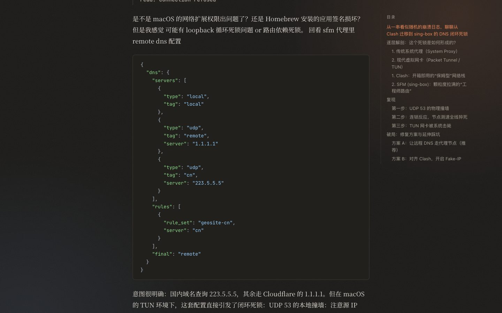
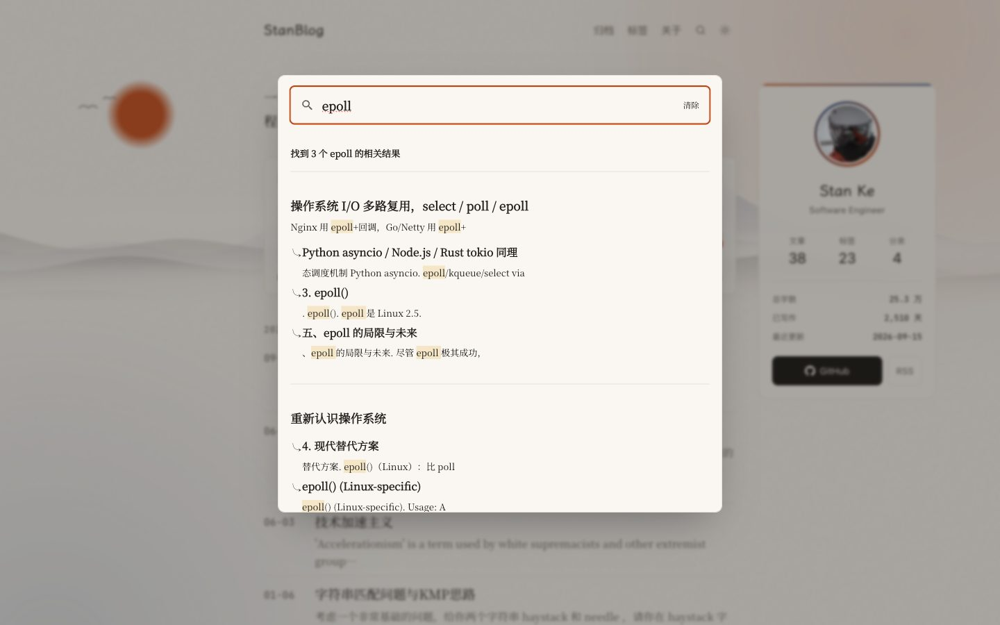
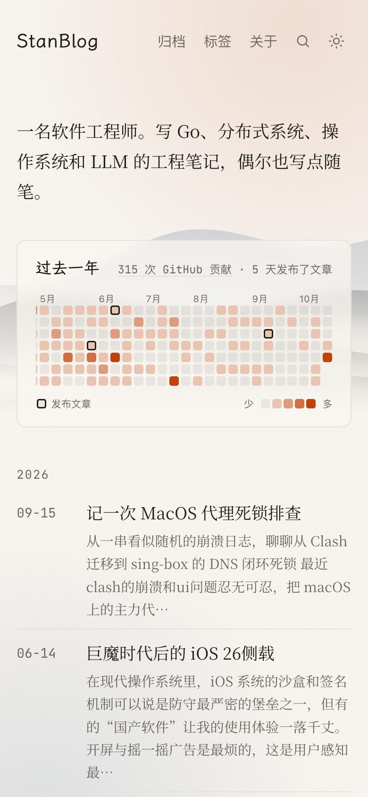

<div align="center">

# StanBlog

**一个安静、像书一样的 Astro 博客模板，为中英文技术写作而设计。**

水墨背景 · GitHub 贡献热力图 · ⌘K 搜索 · 浅色 / 深色 · 零前端框架

[](https://github.com/Stan370/stan370.github.io/actions/workflows/page.yml)
[](https://astro.build)
[](LICENSE)

[**在线预览**](https://stan370.github.io/) · [**使用这个模板**](https://github.com/Stan370/stan370.github.io/generate) · [English](README.md)


</div>

## 为什么选它

很多博客主题还停留在 2019 年：轮播图、卡片瀑布流、一堆 jQuery 插件。StanBlog 反过来做：以文字为中心，认真处理中文排版，几乎不加载 JavaScript，同时保留一点恰到好处的画面感。

适合这些人：

- **学生和刚入行的开发者**：想要一个看起来专业、能免费部署在 GitHub Pages 上的个人站，顺便学一下现代的 Astro。
- **用中文写作，或中英混排**：字体、行高、中英文间距和标点都为此调过。
- **想从 Hexo 迁出来的人**：这个仓库本身就是一次 Hexo → Astro 迁移，构建时会校验所有旧链接依然可访问（见[从 Hexo 迁移](#从-hexo-迁移)）。

## 功能

**阅读体验**
- 680px 单栏版心；正文思源宋体（Noto Serif SC），标题霞鹜文楷，代码 JetBrains Mono。字体按 `unicode-range` 分片自托管，不依赖 Google Fonts。
- 中文排版：1.8 行高；构建时自动在中英文之间加空格（`select()` 这类代码不受影响）；英文文章使用西文引号。
- 粘性目录并高亮当前章节、纯 CSS 阅读进度条、上一篇 / 下一篇。
- Expressive Code 代码块（文件名、行高亮、复制按钮）；KaTeX 只在含公式的页面加载。

**视觉**
- 纸色与墨色为底，朱砂作唯一强调色；浅色 / 深色跟随系统，可手动切换，加载时不闪烁。
- 首页水墨山水横幅：构建时生成的 SVG，雾气缓慢流动；全站有纸张纹理与柔和色晕。系统开启「减少动态效果」时一切动画停止。
- 原生 View Transitions 页面过渡。

**首页与侧栏**
- **贡献热力图**：构建时拉取你过去一年的 GitHub 贡献（无需 token），并标出发文的日子。
- **个人卡片**：随页面滚动，展示头像、文章 / 标签 / 分类数、总字数、写作天数和最近更新。

**搜索、SEO 与订阅**
- Pagefind 全文搜索，⌘K / Ctrl K 打开，中英文混合索引。
- canonical、Open Graph / Twitter Card、JSON-LD、sitemap、robots.txt，并按内容自动判断每页的 `lang`。
- **每篇文章自动生成社交分享图**（构建时用 Satori 渲染，支持中文标题）。
- 全文 RSS。

**可选功能（配置后才开启）**
- Giscus 评论（基于 GitHub Discussions）、GA4、Google AdSense。

<table>
  <tr>
    <td></td>
    <td></td>
    <td width="22%"></td>
  </tr>
  <tr>
    <td align="center">深色模式文章页</td>
    <td align="center">⌘K 搜索</td>
    <td align="center">手机</td>
  </tr>
</table>

## 性能

Lighthouse（移动端，慢速 4G，devtools 节流）测一篇长文：**Performance 96 · Accessibility 100 · SEO 100**。文章页只有三段小脚本（主题切换、目录高亮、失效图片占位），没有任何前端框架运行时。

## 快速开始

需要 [Node.js](https://nodejs.org) 22.23 或更高版本，以及一个 GitHub 账号。

1. 点击 [**使用这个模板**](https://github.com/Stan370/stan370.github.io/generate)，新仓库命名为 **`<你的用户名>.github.io`**。
2. 在新仓库的 **Settings → Pages** 里，把 **Source** 设为 **GitHub Actions**。
3. 克隆到本地运行：

   ```bash
   npm install
   npm run dev        # http://localhost:4321
   ```

4. 按下一节改成你自己的，推送到 `main`。GitHub Actions 会自动构建并发布到 `https://<你的用户名>.github.io/`。

## 改成你自己的

几乎所有设置都在 [`src/site.config.ts`](src/site.config.ts) 一个文件里：

| 字段 | 填什么 |
| --- | --- |
| `url` | `https://<你的用户名>.github.io` |
| `title`、`author`、`career`、`intro`、`description` | 站名、名字、职业、一句话简介、SEO 描述 |
| `githubUser` | 你的 GitHub 用户名（用于贡献热力图和 GitHub 按钮） |
| `social` | 页脚和关于页的链接，按显示顺序 |
| `adsenseClient` | **改成 `''`**，除非你有自己的 AdSense 账号 |
| `ga4Id` | GA4 衡量 ID，不用就留空 |
| `giscus` | 从 [giscus.app](https://giscus.app) 获取的仓库与 ID，不用就留空 |

然后清掉原作者的内容：

```bash
rm -rf src/content/posts/* src/content/notes/*      # 文章和笔记
rm -rf public/medias public/page public/about public/*.html public/ads.txt
: > scripts/legacy-urls.txt                          # 旧链接校验清空
```

最后替换 `public/avatar.jpg` 和 `public/favicon.png`，并改写 [`src/pages/about.astro`](src/pages/about.astro)。

## 写文章

在 `src/content/posts/` 下新建 Markdown 文件。带图片的文章可以用「文件夹 + `index.md`」，图片放在同一目录：

```markdown
---
title: epoll 到底是怎么工作的
date: 2026-10-22 20:00:00
tags: [Linux, 网络]
categories: [系统]
description: 可选，用于列表摘要和 SEO；不写则自动截取正文开头。
img: /medias/epoll-cover.jpg   # 可选封面图（public/ 下的文件或完整 URL）
---

正文。代码块、表格、脚注和 $公式$ 都支持。
```

文章地址为 `/:year/:month/:day/:文件路径/`。其他 front matter：`hide: true` 不出现在列表中，`draft: true` 完全不生成，`lang: en` 手动指定语言。

## 自定义

- **颜色**：[`src/styles/global.css`](src/styles/global.css) 顶部的 `--paper`、`--ink`、`--accent`、`--indigo`，各有一份深色模式的值。
- **字体**：同一文件里的 `--font-serif`、`--font-heading`、`--font-mono`；字体包在 [`src/layouts/Base.astro`](src/layouts/Base.astro) 中引入。
- **横幅**：[`src/components/InkHero.astro`](src/components/InkHero.astro)，改 `ridge(…)` 的种子就能换一片山。
- **界面语言**：界面文字（归档、标签、目录……）是中文，在 `src/components/` 里，需要的话搜索替换即可。

```
src/
├── content/posts/     你的文章（Markdown）
├── components/        页头、目录、搜索、热力图、个人卡片……
├── layouts/           Base（head 与 SEO）和 Post
├── pages/             路由：首页、归档、标签、分类、关于、RSS、分享图、robots
├── plugins/           remark / rehype 插件（中英文空格、标题层级、图片修复）
├── styles/            设计 token 与正文排版
└── site.config.ts     全站设置
```

## 常用命令

| 命令 | 作用 |
| --- | --- |
| `npm run dev` | 启动开发服务器（搜索需要先构建一次） |
| `npm run build` | 类型检查 → 构建 → Pagefind 索引 → 旧链接校验 |
| `npm run preview` | 本地预览构建结果 |

## 从 Hexo 迁移

这个博客 2019–2025 年用的是 Hexo + hexo-theme-matery，迁移时所有链接都保持不变，你的博客也可以照着做：

- 完整复刻 Hexo 的 `:year/:month/:day/:title/` 链接：保留原文件名（包括空格和大小写），日期不受时区影响，标签 / 分类的 slug 规则与 Hexo 一致。
- `scripts/legacy-urls.txt` 记录旧站的全部 URL，每次构建后 `scripts/check-urls.mjs` 都会检查，缺任何一个都会报错。
- Typora 留下的 `C:\…` 本地图片路径会显示为占位并在构建时列出，不会让构建失败。

迁移你自己的 Hexo 博客：把 `source/_posts` 复制到 `src/content/posts`，在 `scripts/legacy-urls.txt` 里列出旧链接，然后反复运行 `npm run build` 直到校验通过。

## 参与贡献

欢迎提 Issue 和 PR，尤其是排版问题、无障碍问题，以及英文界面文字的支持。如果这个模板帮你搭起了博客，**点个 ⭐ 能让更多人看到它**，也欢迎在 Issue 里留下你的站点链接。

## License

代码使用 [MIT License](LICENSE)。`src/content/` 中的文章是作者的个人作品，请勿转载。
