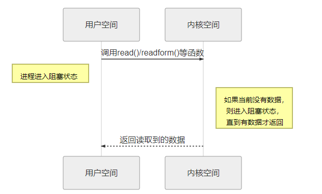
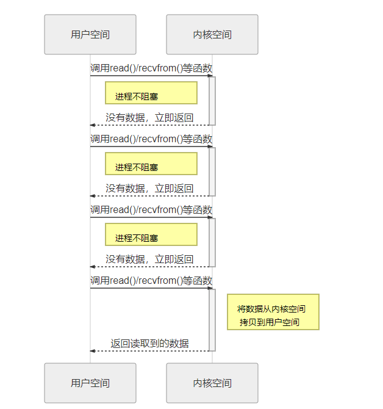

In modern computer systems, I/O is often the decisive performance bottleneck—especially in network servers and storage-heavy applications. Have you ever wondered why network I/O behaves so differently from local disk I/O, or why network transfers are consistently slower than local drives?

`select()`, `poll()`, and `epoll()` are OS primitives used in network programming to monitor multiple file descriptors simultaneously and see whether any are ready for reading or writing. They sit at the foundation of event-driven servers handling massive concurrency. Why is `epoll` so much faster than `select()` and `poll()`? This note walks through the mechanics behind `epoll` and how modern runtimes build high-concurrency systems on top of it.

Operating systems split execution into kernel space and user space. Any user-space I/O operation (reading files, sending or receiving on sockets) enters kernel space via a system call to perform the underlying work.

## Blocking I/O

In blocking I/O mode, a system call such as `read()` or `recvfrom()` suspends the calling thread until the kernel has data ready and copies it into user space. While blocked, the CPU can run other threads, but this thread cannot make progress on anything else. Under high concurrency, blocking per connection burns massive thread resources waiting on I/O. On Linux, sockets default to blocking mode; a typical read flow looks like this: 

When a user process invokes `read()` or `recvfrom()`, execution transitions into kernel space. If no network data has arrived yet, the kernel waits—and the user process remains blocked until data arrives and is copied from kernel memory into user space. Thus blocking I/O stalls the thread across both phases (waiting for data readiness and copying data to user space).

## Non-Blocking I/O

Non-blocking I/O allows a process to invoke `read()` or `recvfrom()` and receive an immediate return even when data is not ready—the kernel returns an error (`EAGAIN` / `EWOULDBLOCK`) instead of parking the thread. The application then polls repeatedly until data becomes available. This avoids blocking the thread, but tight polling wastes CPU cycles: 

## Multiplexed I/O

Multiplexed I/O (`select()`, `poll()`, `epoll()`) lets a single thread monitor many file descriptors (such as sockets) at once and wake up when one or more become ready. Compared with busy-polling non-blocking sockets, multiplexing scales far better for servers juggling thousands or millions of connections.

Local file I/O is typically blocking, though modern operating systems provide asynchronous I/O interfaces (such as Linux AIO, `io_uring`, or Windows IOCP). In network servers, combining non-blocking sockets, I/O multiplexing (`select`/`poll`/`epoll`/`kqueue`), and event-driven libraries (`libuv`, `libevent`) is the standard way to tame latency and concurrency.

Pairing coroutines with I/O multiplexing unlocks ergonomic, high-throughput concurrent servers.

In Unix, a **socket** is an abstraction for inter-process or network communication created via `int socket(int domain, int type, int protocol)`, which returns a file descriptor (`fd`). Because Unix treats sockets as file descriptors (“everything is a file”), processes communicate over the network by reading and writing `fd`s. **By monitoring many sockets with I/O multiplexing and resuming the corresponding coroutine whenever a socket becomes readable or writable, a small pool of OS threads can drive enormous concurrency.**

### A Concrete Example: Go

Go’s goroutine model illustrates this cleanly:

```go
func handler(conn net.Conn) {
    buf := make([]byte, 1024)
    for {
        n, err := conn.Read(buf)
        if err != nil { return }
        conn.Write(buf[:n])
    }
}

func main() {
    ln, _ := net.Listen("tcp", ":8080")
    for {
        conn, _ := ln.Accept()
        go handler(conn)
    }
}
```

On the surface, each `conn.Read()` looks blocking. Under the hood, however:

* The Go runtime registers every socket with `epoll` (or `kqueue`/`IOCP`);
* When a goroutine calls `Read()` and no data is ready, the runtime:
  1. Parks the current goroutine;
  2. Registers its `fd` with the netpoller (`epoll`);
  3. Schedules another runnable goroutine on the OS thread;
  4. Resumes the parked goroutine as soon as `epoll` signals readability.

Switching happens entirely in user space—the OS thread never blocks. **That is why you can spawn 100,000+ goroutines backed by only a handful of OS threads (M:N scheduling).**

### Python asyncio / Node.js / Rust tokio Follow the Same Pattern

| Runtime | Underlying I/O Multiplexer | User-Space Scheduler |
|---|---|---|
| Python asyncio | `epoll`/`kqueue`/`select` via `selectors` | Event loop scheduling coroutines |
| Node.js (libuv) | `epoll`/`kqueue`/`IOCP` | Single-threaded event loop |
| Rust tokio | `epoll`/`kqueue`/`wepoll` | Future + reactor model |
| Go runtime | `epoll`/`kqueue`/`IOCP` | M:N goroutine scheduler |

Every one of these runtimes follows the same recipe: manage I/O centrally with `epoll` (or platform equivalent), yield tasks automatically on I/O waits, and resume them upon readiness.

---

### Core Architecture Diagram (Simplified)

```
        User Code Layer
  ┌──────────────────────────────┐
  │ async/await / goroutine / go │
  │ yield / await / resume       │
  └──────────────────────────────┘
                │
                ▼
   Runtime Scheduler (User Space)
  ┌──────────────────────────────┐
  │ epoll_wait()                 │
  │ callbacks, event & task queues│
  └──────────────────────────────┘
                │
                ▼
        Kernel I/O Layer
  ┌──────────────────────────────┐
  │ socket, file, pipe, epoll_fd │
  │ NIC interrupts, DMA, queues  │
  └──────────────────────────────┘
```

Coroutines are the *task units* on the event loop; I/O multiplexing is the *signal source* driving it. Whether it’s Nginx (`epoll` + callbacks) or Go/Netty (`epoll` + coroutines/threads), both scale comfortably to millions of concurrent connections.

---

## 1. `select()`

Monitors sets of file descriptors for readability, writability, or error conditions.

Limitations:
- Hard cap on the maximum descriptor value (typically 1024, defined by `FD_SETSIZE`), quickly becoming a bottleneck for high-concurrency servers.
- Linear scan overhead: the kernel and user code inspect every descriptor on every call.
- Uses bitmask sets that must be reset and copied into kernel space on each invocation.

Example:
`fd_set readfds; FD_ZERO(&readfds); FD_SET(socket_fd, &readfds); select(socket_fd + 1, &readfds, NULL, NULL, &timeout);`

## 2. `poll()`

Works much like `select()`, except descriptors are passed as an array of `struct pollfd` (converted to a linked list in the kernel) with no `FD_SETSIZE` ceiling: `int poll(struct pollfd *fds, nfds_t nfds, int timeout);`

Advantage: `struct pollfd` scales beyond 1024 descriptors without bitmask size limits, though it still requires copying the full descriptor array and scanning linearly in $O(n)$ on every call.

Example:
`struct pollfd fds[2]; fds[0].fd = socket_fd; fds[0].events = POLLIN; poll(fds, 2, timeout);`

## 3. `epoll()`

Introduced in Linux 2.5.44 (2002), `epoll` was built specifically for high-concurrency I/O multiplexing.

Rather than a single call, `epoll` exposes three syscalls:

- `epoll_create1()`: creates an epoll instance and returns its file descriptor (`epfd`);
- `epoll_ctl()`: registers, modifies, or removes watched `fd`s and their interested events (`EPOLLIN`, `EPOLLOUT`, etc.);
- `epoll_wait()`: waits until one or more watched `fd`s become ready and returns only the ready events.

### 3.1 Why `epoll` Breaks Through `select`/`poll` Bottlenecks

#### (1) Kernel Data Structures: Red-Black Tree + Ready List

- **Red-black tree (`rb-tree`)**: stores all registered `fd`s via `epoll_ctl(EPOLL_CTL_ADD)`.
  - $O(\log n)$ insert/delete cleanly supports millions of connections;
  - Eliminates copying the full `fd` set from user space on every wait.

- **Ready list (`rdllist`)**: a doubly linked list maintained by the kernel.
  - When a watched `fd` becomes readable or writable, a kernel callback appends its `epitem` directly to the ready list;
  - `epoll_wait()` simply drains the ready list without scanning idle connections.

> That is the core of `epoll`’s speed: **event-driven kernel callbacks**, not linear polling.

#### (2) No Repeated Full-Set Copying

- `select`/`poll`: copies the entire descriptor set from user space to kernel space on every call;
- `epoll`: each `fd` is registered once via `epoll_ctl()`, slashing syscall and memory-copy overhead.

> Note: Early discussions often claimed `epoll` relies on `mmap` shared memory; modern kernels use efficient ring buffers or direct copying without needing `mmap`.

#### (3) Time Complexity: From $O(n)$ to $O(k)$

- `select`/`poll`: **$O(n)$** in total watched descriptors—even if only 1 out of 1,000 sockets is active, all 1,000 are scanned.
- `epoll_wait()`: **$O(k)$** in *active* descriptors only.
- In a C1000K workload (1,000,000 connections, 1,000 active), `epoll` delivers orders-of-magnitude higher efficiency.

---

### 3.2 ET (Edge-Triggered) vs. LT (Level-Triggered)

`epoll` supports two notification modes with very different semantics:

| Mode | Behavior | Typical Use |
|---|---|---|
| **LT (Level-Triggered, default)** | As long as the `fd` remains ready (e.g., unread bytes stay in the receive buffer), every `epoll_wait()` reports it again. | Simpler and safer to program, though repeated notifications can increase syscalls. |
| **ET (Edge-Triggered)** | Fires **only on state transitions** (e.g., new data arrives). If you don’t drain the buffer completely, subsequent `epoll_wait()` calls **will not notify you again**. | Maximum performance; requires **non-blocking `fd`s** and reading in a loop until `EAGAIN`. |

#### Essential ET Usage Pattern

```c
// Set socket to non-blocking
int flags = fcntl(sockfd, F_GETFL, 0);
fcntl(sockfd, F_SETFL, flags | O_NONBLOCK);

// Register in Edge-Triggered mode
ev.events = EPOLLIN | EPOLLET;
epoll_ctl(epfd, EPOLL_CTL_ADD, sockfd, &ev);

// Event handler
void handle_event(int sockfd) {
    char buf[4096];
    ssize_t n;
    while ((n = read(sockfd, buf, sizeof(buf))) > 0) {
        // Process data
    }
    if (n == -1 && errno != EAGAIN) {
        // Real error
        close(sockfd);
    }
    // n == -1 && errno == EAGAIN means the buffer is drained
}
```

> ⚠️ **In ET mode, failing to drain all available data can stall the connection permanently.**

---

## 4. The Reactor Pattern: Classic Server Architecture on `epoll`

The most naive concurrent server spawns one thread (or process) per connection. At high concurrency, that hits two walls:
- Creation, stack allocation, and context-switching overhead;
- Hard OS thread limits.

Thread pools reuse threads, yet blocking `read()` calls still pin worker threads idle while waiting on slow peers. Non-blocking polling avoids blocking but burns CPU.

The **Reactor pattern** solves this via event-driven dispatch:
> **“One or more input sources → an event demultiplexer (Reactor) → multiple event handlers”**

On Linux, **`epoll` serves as the Reactor’s event demultiplexer**.

### 4.1 Single Reactor, Single Thread (e.g., Redis)

- **Design**: One thread runs the `epoll` loop, handling both I/O (`accept`, `read`, `write`) and business logic serially.
- **Pros**: Zero locks, zero race conditions, zero context-switch overhead.
- **Cons**: Business logic must never block; cannot leverage multiple CPU cores within one instance.
- **Best for**: Ultra-fast, I/O-bound workloads with tiny handler cost (in-memory KV stores).

### 4.2 Single Reactor, Multi-Thread (e.g., early Nginx patterns)

- **Design**: One main thread runs `epoll` for all sockets and dispatches readable/writable work onto a worker thread pool.
- **Pros**: Uses multiple cores; workers may execute blocking work.
- **Cons**: Single-threaded I/O dispatch can eventually saturate; passing tasks across threads requires synchronization.

### 4.3 Main/Sub Reactor (e.g., Netty, Swoole)

- **Design**:
  - **Main Reactor**: watches only the listening socket (`accept()`), handing accepted connections off to Sub Reactors;
  - **Sub Reactors**: each runs its own `epoll` loop managing a shard of connections, optionally offloading heavy logic to a worker pool.
- **Pros**: Full parallelism between `accept` and I/O; lock-free per-connection ownership; effortlessly scales to millions of connections.
- **Key mechanisms**:
  - `SO_REUSEPORT` (Linux 3.9+) lets multiple threads/processes bind the same port with kernel load balancing, avoiding thundering herds;
  - Pinning each Sub Reactor to a CPU core improves cache locality.

> 📌 **Netty’s `EventLoopGroup` is a textbook implementation of a Sub Reactor pool.**

---

## 5. Limitations of `epoll` and What Comes Next

Despite its dominance, `epoll` has inherent limits:
- Still **synchronous readiness notification**: user space still executes `read()`/`write()` itself;
- Requires at least two syscalls per I/O (`epoll_wait` + `read`/`write`);
- Poor fit for regular disk file I/O (regular files are always reported “ready”).

**The next generation: `io_uring` (Linux 5.1+)**
- User space submits I/O requests into a shared ring buffer and the kernel completes them asynchronously;
- Unifies **network I/O, file I/O, and `epoll` replacement**;
- Batches submission and completion in as little as **one syscall** (or zero with SQPOLL);
- Already being adopted by Redis 7.0+, Nginx, and Tokio.

Even so, **`epoll` + Reactor remains the de-facto workhorse of Linux high-concurrency servers today.**
