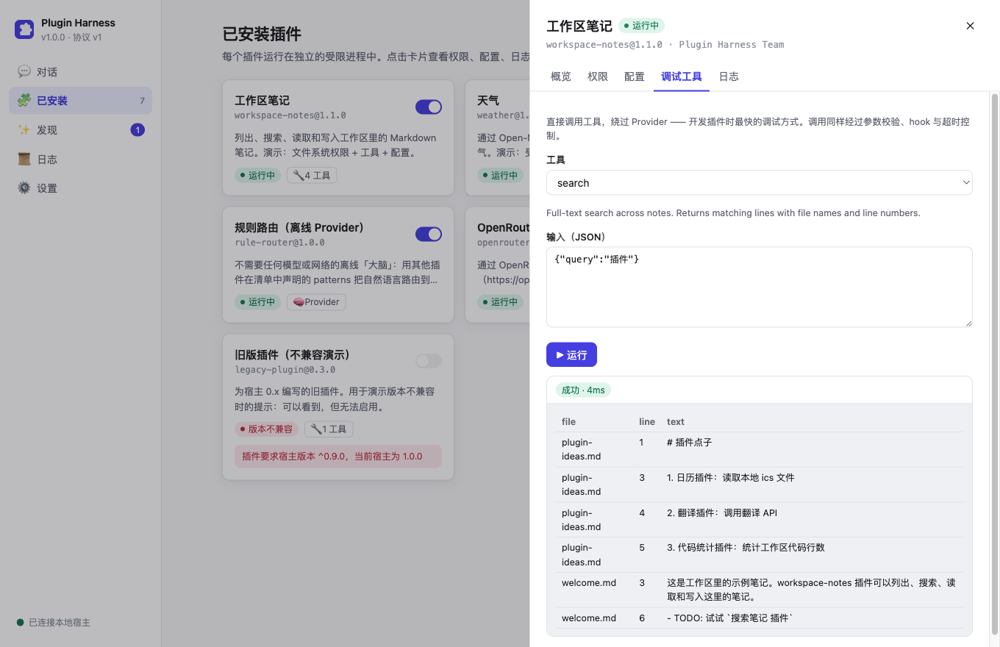

## Overview

[Plugin Harness](https://github.com/Stan370/plugin-harness) is a locally run AI Agent Harness offering both a CLI and a local Web UI with zero third-party npm dependencies. Rather than packing in the largest catalog of built-in Agent features, it uses a runnable, observable, verifiable plugin boundary to answer one concrete question: can a plugin architecture genuinely extend a host, rather than disguising hardcoded `if/else` branches as “plugins”?

- The host itself ships no built-in weather, notes, privacy guard, or LLM capabilities;
- Tools, data-interception Hooks, and Providers are all supplied by standalone plugins;
- Every plugin runs inside an isolated child process;
- Users grant permissions item by item, and the host proxies file, network, and secret access;
- If a plugin crashes, times out, or fails version compatibility, the host keeps running.

## Starting with “Harness”: It’s Not About a Single Model Call

In complex Agent systems, the easiest part to demo is a model call: assemble a prompt, query an LLM, parse a tool call, and pass the result back. That proves a minimal loop, yet skips the harder engineering questions: Which tools may the model invoke? Are the arguments valid? Where is data redacted, blocked, and audited? How does the system recover if a plugin hangs or crashes? Can the user observe execution state? Was the final claim independently verified?

I call the layer wrapping the model, tools, and plugins—owning their full lifecycle—the **Harness**. It is more than an agent loop; it is the runtime and control plane around the loop: capability discovery, tool dispatch, permission enforcement, event streaming, process supervision, fault recovery, audit logging, and verification. A Harness places non-deterministic model decisions inside deterministic execution boundaries.

Models excel at grasping intent, planning steps, and composing language, yet they should never act as the sole permission arbiter, process supervisor, or ground-truth verifier. Models can get better at choosing tools, but cannot replace the host in deciding whether a call exceeds granted permissions; they can suggest fixes, but cannot replace timeout reclamation; they can write confident summaries, but cannot substitute for evidence from files, tests, or network responses; they can understand workflows, but cannot replace a state machine deciding when to restart, upgrade, or circuit-break a plugin.

Across 2025–2026 Agent engineering discussions, the question has moved well beyond “can we wire an LLM to tools?” to whether a system can constrain behavior, recover from faults, and verify outcomes. I prefer walking through this execution chain: the model proposes an action, the host adjudicates permissions and dispatches it, the plugin executes the capability, and the system records evidence and exposes recovery controls. Shallow orchestration may gradually be absorbed by stronger models, yet governance, verification, security, and lifecycle management still require a runtime foundation outside the model.

## Why Build This Project

I wanted to answer a deceptively simple question that is easy to gloss over: does a plugin mechanism genuinely extend the host, or merely dress up hardcoded host branches?

Many projects expose a “plugin interface” while keeping the agent loop, tool dispatch, providers, permissions, and UI tightly coupled inside the host. Plugin Harness tries to prove the opposite architecturally: the host owns only stable, generic mechanisms, while concrete capabilities are declared and implemented externally.

## Mapping Concepts to Implementation

These terms often appear together even though they solve different problems. The table below juxtaposes what is actually built against where the architecture can evolve:

| Concept | Problem It Solves | Where It Lives in Plugin Harness |
|---|---|---|
| Harness | Controlled execution runtime around model calls and agent lifecycle | Host, agent loop, tool dispatch, process supervision, permission proxy, audit logs, and state reconciliation. |
| Plugin | Decoupling capabilities from the host binary | Manifest + entry point running in an isolated child process; can provide tools, hooks, providers, and settings. |
| MCP | Standard protocol for discovering and invoking tools/resources | Full MCP is not implemented; custom JSON-RPC IPC establishes a similar inter-process boundary without claiming MCP compliance. |
| Skill | Reusable task procedures, domain knowledge, constraints, and tool usage guidance | No standalone Skill system yet. Tool descriptions and schemas in manifests declare capabilities, which are not equivalent to Skills. |
| Hook | Cross-cutting interception before/after lifecycle stages | Hooks run on user messages, tool invocations, and tool results with priority ordering and `open`/`closed` failure policies. |
| Agentic RAG | Iterative evidence gathering via search, read, and follow-up calls | `workspace-notes` list/search/read/write tools provide lightweight local retrieval and iterative edits; no vector index or reranker pipeline. |
| Event-Driven Orchestration | Propagating execution progress and lifecycle transitions as events | IPC messages, `PluginProcess` lifecycle events, Host `EventEmitter`, logs, SSE, progress, and plugin status events connect end to end. |
| Self-Checks & Circuit Breaking | Validating preconditions and containing repeated failures | Argument schema validation, timeouts and process reclamation, OOM detection, backoff restarts, crash-loop circuit breaking, and configurable hook failure modes. |
| Executable Verification | Verifying behavior with repeatable checks and external facts | `node:test` contract suites, chaos-monkey fault injection, permission-denial assertions, audit logs, and end-to-end tests against live APIs. |

Keep implementation distinct from roadmap: pluginized tools, hooks, providers, process isolation, JSON-RPC, and event streams are implemented; full MCP transport, standalone Skill registries, and vector RAG pipelines are not. The design provides clean boundaries for them, and “extensible toward X” is not the same as “already built.”

## Proving the Host Is Truly Extended

The most direct proof is disabling a plugin and observing that capability vanish cleanly from the host.

`workspace-notes` supplies note listing, search, read, and write tools; `weather` provides weather queries; `pii-guard` redacts and intercepts sensitive data flowing through messages and tool outputs; `rule-router` and `openrouter-provider` supply an offline deterministic Provider and a live LLM Provider respectively.

Beyond model-driven calls, the host exposes a direct debug console where you pick any plugin tool, supply raw JSON arguments, and bypass the Provider completely. Calls still traverse schema validation, hooks, and timeouts, letting you isolate whether a bug lives in the tool implementation or in model reasoning.



The single most telling experiment is swapping Providers:

- With `rule-router`, local regex and deterministic rules drive conversations and tool calls offline;
- With `openrouter-provider`, the exact same tool protocol connects to a real tool-calling LLM;
- Both Providers are simply plugins discovered and loaded by the host—the agent loop never changes.

That proves what the host truly owns is the *ability to run an agent turn*, not any particular model or fixed toolset. A typical turn unfolds along an explicit control chain:

```text
用户输⼊ (User input)
  -> Input Hook inspects or redacts
  -> Provider emits text or tool call
  -> Host validates tool name and argument schema
  -> Host checks permissions and dispatches to isolated plugin process
  -> Plugin accesses files, network, or secrets via host proxy
  -> Output Hook inspects tool result
  -> Host returns result to Provider, or completes the turn
```

Every hop has a clear owner: the model proposes, the host adjudicates and executes, the plugin delivers capability, and hooks apply cross-cutting checks. Once decomposed, security, auditing, and fault handling no longer rely on hoping the prompt obeys instructions.

Notably, `pii-guard` is a pure Hook plugin with zero permissions, yet it can redact inputs before they reach the model and inspect or rewrite tool results across the entire pipeline—without cluttering the agent loop with special-case branches.

## Host vs. Plugin Boundaries

The overall architecture summarizes as:

```text
Browser / CLI
      |
      v
Host
- Agent loop
- Tool dispatch & schema validation
- Hook pipeline
- Plugin process supervision
- Network & secret proxy
- Logging & audit trail
- Declarative Web UI
      |
      | JSON-RPC IPC
      v
Isolated Plugin Process
- Tool implementations
- Hook implementations
- Provider implementations
- Plugin settings
```

The host provides mechanisms; plugins provide capabilities. Via `plugin.json`, a plugin declares its tools, hooks, providers, settings, and required permissions so the host can inspect what it does, what it needs, and whether it is compatible before running a single line of plugin code.

| Boundary | Host Responsibility | Plugin Responsibility |
|---|---|---|
| Tools | Schema validation, timeouts, audit logging, output truncation, dispatch | Declare tool names and input schemas; implement `tool.invoke` |
| Data Governance | Hook ordering, failure policies, cross-session propagation, rollback | Rewrite or block messages, tool inputs, and tool outputs |
| Providers | Maintain agent loop and model invocation protocol | Implement `provider.complete`, handling model routing and requests |
| Settings | Load, persist, hot-reload, and render settings forms | Declare schema, read settings, react to updates |
| Files | Resolve granted paths, launch Node file sandbox | Access only host-granted workspace or private data directories |
| Network | Hostname allowlist, redirect re-validation, size caps, auditing | Make HTTP requests through the host proxy |
| Secrets | Storage, authorization checks, controlled plaintext delivery | Request authorized secrets via host API |
| UI | Render views, handle auth, display chat and logs | Declare tables, cards, quick actions, and settings—no arbitrary JS injection |

Data is never shared as mutable in-process objects; everything crosses JSON-RPC requests and responses. Tool outputs can include both text and declarative `display` descriptors rendered safely by the host.

## Clarifying Adjacent Concepts

### MCP, Plugins, and Skills

MCP focuses on standardized discovery and invocation of capabilities, whereas a Plugin platform must also own installation, upgrades, configuration, authorization, process lifecycles, and crash recovery. Internally this project uses custom JSON-RPC IPC (`activate`, `tool.invoke`, `hook.run`, `provider.complete`)—a clear inter-process capability boundary, though not a full MCP transport or capability-negotiation layer.

Skills and Plugins are likewise distinct: a Plugin owns implementation and lifecycle, a Tool is a single callable capability, and a Skill packages task-oriented steps, domain constraints, and tool choreography. Manifest schemas declare capabilities; they do not replace Skills. In the future, a workflow like “organize workspace notes” could live as a Skill invoking `workspace-notes.search/read/write`, while permissions remain strictly enforced by the host—Skill text can never escalate privileges.

### Agentic RAG: Retrieval as a Tool in the Loop

Classic RAG is often reduced to “retrieve once and stuff chunks into the prompt.” Agentic RAG lets the agent decide whether to search, refine queries, read deeper, and synthesize evidence over multiple turns. `workspace-notes` (`list`, `search`, `read`, `write`) demonstrates that control path locally without claiming to be a full vector search stack: retrieval participates as a schema-validated tool whose results flow through hooks and structured error handling. Extending it toward full RAG means adding indexing/chunking tools returning source citations, scores, and timestamps—and stopping explicitly when evidence is insufficient rather than fabricating confidence.

### Event-Driven Orchestration

Event-driven design here spans multiple layers: plugins emit logs, progress, and requests over IPC; `PluginProcess` tracks lifecycle states (`starting`, `running`, `crashed`, `failed`, `stopped`); the Host publishes unified status, progress, and log events consumed by the CLI and streamed to the Web UI via SSE.

Events describe *what happened*; `state.json` and `reconcile()` decide *what state the system should converge toward next*. Separating reconciliation from notification makes duplicate events and mid-flight failures idempotent: duplicate restart signals never spawn two child processes, and stopping an already exited plugin remains safe.

### Self-Checks, Circuit Breaking, and Executable Truth

Model output is treated as an unverified proposal. Before execution, the host checks tool names, argument schemas, permissions, and plugin health; afterward it validates response shape, size, and errors. Hooks run with `open` (best-effort) or `closed` (fail-safe block) policies so governance never depends on prompt compliance.

Timeouts and circuit breakers bound blast radius: consecutive tool timeouts reclaim wedged processes; repeated crashes within a short window trip the circuit breaker and halt automatic restarts until manual intervention. Turn step caps, output truncation, and OOM detection reinforce those bounds.

I treat **executable verification** as a core rule: architecture docs state expectations, while contract tests and fault injection try to break them. “Plugins cannot read SSH keys” becomes an assertion against an unauthorized read attempt; “a plugin crash never takes down siblings” is checked after injecting a real crash.

## Stability: Plugin Failure Must Not Equal Host Failure

I chose **one Node child process per plugin** rather than in-process loading or Worker threads.

In-process loading is simplest, yet an uncaught exception, infinite loop, or memory leak can take down the entire host. Worker threads still lack full process-level permission boundaries. Child processes give each plugin an independent lifecycle so the host can terminate, restart, or circuit-break one plugin without disturbing the rest:

- Timeouts on activation, tool calls, hooks, and provider calls;
- Forced process reclamation after two consecutive tool timeouts;
- Exponential-backoff restarts after crashes;
- Circuit breaker tripping after three crashes within 60 seconds, requiring manual restart;
- Activation failures treated as deterministic errors (no infinite restart loops);
- Per-plugin heap caps with OOM classified as plugin failure;
- Eight-step maximum per agent turn to prevent runaway tool loops;
- Tool output truncation to protect context windows and UI;
- `state.json` as single source of truth for reconciling desired vs. actual process state.

On compatibility, manifests declare `apiVersion` and host version ranges. Incompatible plugins can be installed but never enabled. Updates requesting new permissions keep the previous version and permissions active until the user approves each addition explicitly.

## Permissions and Security: Never Rely Solely on “Trusting the Plugin”

Permissions combine plugin declaration, user consent, and host enforcement across four scopes:

- `fs.read`: read specific directories;
- `fs.write`: write specific directories;
- `network`: access allowlisted hostnames;
- `secrets`: read named secrets.

Users review each permission’s purpose and risk level during install or update and can revoke any item individually (restarting the plugin with updated grants).

Node 24’s `--permission` model enforces in-process file, child-process, Worker, and native-addon restrictions. Network and secrets are never exposed directly:

- Global `fetch` is replaced by a host proxy that validates target hostnames on every request and every redirect;
- Unauthorized hosts and secrets return explicit errors and write audit entries;
- Plugin processes do not inherit host environment variables;
- Secret files are stored with mode `0600` (with the caveat that once plaintext is delivered to an authorized plugin, the host cannot police subsequent in-process use).

The local Web UI listens strictly on `127.0.0.1`, generates a one-time boot token, validates `Host`, `Origin`, and CSP headers, and renders plugin output strictly as text.

## Security Boundary Demonstration

A dedicated chaos-monkey plugin exercises these boundaries directly:

- Attempts to read SSH keys, `/etc/passwd`, or write `/tmp` are denied by the runtime;
- Unauthorized hosts and raw sockets are blocked;
- Environment variables contain no secrets; unauthorized secret requests fail and are audited;
- Spawning child processes throws `ERR_ACCESS_DENIED`;
- After a hung tool times out, the plugin continues serving subsequent calls;
- Exceeding heap limits terminates only the offending plugin while the host and siblings stay healthy;
- Repeated crashes trip the circuit breaker and recover cleanly on manual restart.

## Key Lessons Learned

### 1. A Plugin Platform Is First a State Machine, Not a Dynamic Loader

Running plugin code is easy; keeping *desired state* and *actual state* convergent across manifest changes, upgrades, revocations, and crashes is the real work. Combining `state.json` with `reconcile()` lets CLI and Web share one consistent source of truth.

### 2. The Most Important Host–Plugin Contract Is the Error Boundary

Defining success payloads is not enough. Timeouts, crashes, permission denials, version mismatches, invalid schemas, hook blocks, and OOMs all need stable error shapes and clear diagnostics.

### 3. Permissions Must Live Across the Entire Execution Chain

Consent screens mean nothing without runtime enforcement. Permissions must flow from manifest declaration → user grant → process launch flags → host proxy checks → revocation restarts → audit logs.

### 4. Declarative Manifests Give the Host Prior Knowledge

Manifests let the host inspect tools, UI descriptors, hooks, permissions, and settings before executing plugin code—unlocking genuine host extensibility without hardcoded feature branches.

### 5. Be Honest About Security Boundaries

This is not an absolute sandbox. Node’s permission model enforces filesystem, child-process, and Worker limits, while network isolation relies on in-process patching and the host proxy. Untrusted third-party code still warrants OS-level isolation such as macOS `sandbox-exec`, Linux namespaces/seccomp, or containers, plus plugin signing.

### 6. Model Capabilities Evolve; Execution Accountability Does Not Disappear

Models will keep absorbing more surface-level planning and routing. Even so, no model can unilaterally grant itself filesystem access, bypass network allowlists, or self-certify that a side effect succeeded. A Harness does not compete with model intelligence—it is the runtime substrate that makes model capability safe, inspectable, and accountable.

## Verification and Known Limitations

Automated tests using `node:test` cover manifest contracts, version compatibility, permissions, sandboxing, timeouts, crashes, circuit breaking, OOM, hooks, update approvals, and Web security—36 test cases passing on Node 24.10.0 / macOS alongside end-to-end verification against live Weather and OpenRouter APIs.

Current limitations remain explicit:

- Network isolation is not OS-level;
- Authorized plugins receive secret values in plaintext;
- No plugin code signing or remote trusted marketplace yet;
- No hard CPU quotas;
- Plugins are Node.js-only;
- Declarative UI forbids custom plugin-injected components.

These boundaries clarify where the prototype stops and where production hardening for untrusted ecosystems would begin—turning “plugins, isolation, permissions, compatibility, and recovery” from documentation promises into a runnable, observable, verifiable system.
