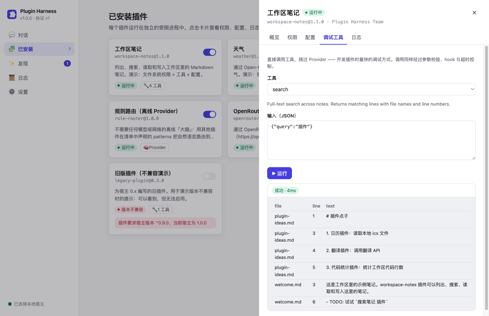

## 项目简介

这是一个本地运行的 [AI Agent Harness](https://github.com/Stan370/plugin-harness)，提供 CLI 和本地 Web 应用，零 npm 第三方依赖。它不追求内置最多的 Agent 功能，而是用一个可运行、可观察、可验证的插件边界回答一个具体问题：插件机制是否真的能扩展宿主，而不是把插件伪装成主程序里的条件分支？

- 主程序不内置天气、笔记、隐私治理或大模型能力；
- 工具、数据拦截 Hook 和 Provider 都由独立插件提供；
- 每个插件运行在独立进程中；
- 用户逐项授予权限，宿主代理文件、网络和密钥访问；
- 插件崩溃、超时或版本不兼容时，宿主仍能继续运行。

## 从概念 Harness 说起：它解决的不是一次模型调用

做复杂 Agent 系统时，最容易展示的是模型调用：拼 prompt、请求 LLM、解析工具调用，再把结果交回去。这能跑通一个最小循环，却没有回答工程上更重要的问题：模型可以使用哪些工具？参数是否合规？数据在哪里被修改、拦截和审计？插件挂起或崩溃后如何恢复？用户能否看见执行状态？最终结论有没有经过独立验证？

我把包住模型、工具和插件，并负责它们全生命周期的这一层称为 **Harness**。它不只是 Agent loop，而是围绕循环建立的运行时和控制面：能力发现、工具调度、权限校验、事件流、进程监管、错误恢复、日志审计和结果验证。Harness 让不确定的模型决策进入确定的执行边界。

模型擅长理解意图、规划步骤和组织自然语言，但它不应该成为唯一的权限仲裁者、进程管理器或事实校验器。模型可以越来越擅长选工具，却不能替代宿主判断调用是否越权；可以尝试修复错误，却不能替代超时回收；可以生成可信口吻的结论，却不能替代文件、测试或网络状态提供的证据；可以理解工作流，却不能替代状态机决定插件该重启、更新还是熔断。

至少在我观察到的 2025–2026 年 Agent 工程讨论里，问题已经不止于“能不能写一个 LLM 加工具的脚本”，还包括系统能否控制行为、恢复故障并验证结果。我更愿意在面试里围绕这条执行链展开：模型提出行动，宿主裁决权限并调度，插件完成能力，系统记录结果并提供恢复入口。表层编排可能逐渐被模型内化，但管控、校验、安全与生命周期管理仍需要模型之外的运行底座。

## 为什么做这个项目

我想回答一个看起来简单、实际上很容易含糊其辞的问题：插件机制是不是真能扩展宿主，而不是把插件功能伪装成主程序里的分支？

很多项目会提供一个“插件接口”，但 Agent 循环、工具调用、Provider、权限和界面仍然集中在宿主里；第三方功能只是以硬编码方式接在特定位置。Plugin Harness 希望从架构上证明另一件事：宿主只负责稳定、通用的机制，具体能力由外部插件声明和实现。

## 概念如何落在项目里

这几个概念经常一起出现，但它们解决的问题不同。下表把已实现的能力和当前边界放在一起，方便区分“项目已经做到什么”与“架构可以往哪里扩展”。

| 概念 | 它解决的问题 | Plugin Harness 中的落点 |
|---|---|---|
| Harness | 为模型调用和 Agent 生命周期提供受控的执行底座 | Host、Agent 循环、工具调度、进程监管、权限代理、日志审计和状态协调。 |
| Plugin | 让能力脱离宿主主程序独立存在 | 一个插件由清单和入口组成，运行在独立进程中；可提供 tools、hooks、providers 和 settings。 |
| MCP | 用标准协议发现和调用工具、资源等能力 | 项目未实现完整 MCP；内部使用自定义 JSON-RPC IPC，提供相似的进程间能力边界，但不是 MCP 实现。 |
| Skill | 给模型提供可复用的任务步骤、知识、约束和工具用法 | 当前没有独立 Skill 系统。Plugin manifest 中的 tool 描述和 schema 是能力声明，不等同于 Skill。 |
| Hook | 在正常流程节点前后插入横切逻辑 | 用户消息、工具调用及工具结果等节点可运行 Hook；支持优先级和 `open/closed` 失败策略。 |
| Agentic RAG | 让 Agent 通过检索、阅读和后续调用逐步收集证据 | `workspace-notes` 的 list/search/read/write 工具提供轻量的本地检索与迭代读写基础；没有向量索引、重排序等检索流水线。 |
| 事件驱动编排 | 将执行进度和生命周期变化作为事件传播 | IPC 消息、`PluginProcess` 生命周期事件、Host `EventEmitter`、日志、SSE、进度和插件状态事件相互衔接。 |
| 自校验与熔断 | 检查执行条件，并限制重复故障的影响范围 | 参数 schema 校验、超时与进程回收、OOM 识别、退避重启、连续崩溃熔断，以及可配置的 Hook 失败策略。 |
| 可执行真值验证 | 用可重复的检查和外部事实验证系统行为 | `node:test` 契约用例、混沌猴故障注入、权限拒绝断言、审计日志，以及真实接口的端到端验收。 |

因此，面试时我会清楚区分实现与演进方向：已经实现的是插件化工具、Hook、Provider、进程隔离、JSON-RPC 和事件流；没有实现完整 MCP 传输层、独立 Skill 注册或向量检索流水线。现有设计提供了接入这些能力的边界，但“可以演进”不等于“已经实现”。

## 怎么证明宿主被真正扩展了

最直接的证据，是禁用一个插件时观察宿主能力是否随之消失。

`workspace-notes` 提供列出、搜索、读取和写入笔记的工具；`weather` 提供天气查询工具；`pii-guard` 在用户消息和工具结果经过宿主时做脱敏与拦截；`rule-router` 和 `openrouter-provider` 分别提供离线 Provider 与真实大模型 Provider。

除了让模型发起工具调用，宿主也提供直接调试入口：可以选定插件工具并输入 JSON 参数，绕过 Provider 单独检查插件实现。调用仍经过相同的参数校验、Hook 和超时控制，因此能把问题定位在工具实现或 Agent 决策这一侧。



其中，最重要的一个实验是切换 Provider：

- 使用 `rule-router` 时，可以用正则和确定性规则完成本地对话和工具调用；
- 使用 `openrouter-provider` 时，同一套工具调用协议可以接入支持工具调用的大模型；
- 两个 Provider 都只是宿主发现并加载的插件，不需要改 Agent 主循环。

这说明宿主真正拥有的是“运行一次 Agent 对话”的能力，而不是某一种模型或某一组固定工具。Provider 和工具都通过约定注册；Agent 循环只负责选择 Provider、生成调用、执行工具和处理返回结果。

可以把一次典型执行拆成一条清楚的控制链：

```text
用户输入
  -> 输入 Hook 检查或脱敏
  -> Provider 生成文本或工具调用
  -> 宿主校验工具名和参数 schema
  -> 宿主检查权限并调度独立插件进程
  -> 插件经宿主代理访问文件、网络或密钥
  -> 输出 Hook 检查工具结果
  -> 宿主把结果交回 Provider，或结束本轮
```

每一段都对应一个明确的责任人。模型负责建议，宿主负责裁决和执行，插件负责实现能力，Hook 负责横切检查。把流程拆开后，安全、审计和故障处理就不必寄希望于 prompt 遵守约定。

另外，`pii-guard` 使用的是纯 Hook 插件、零权限，却能横切修改和拦截整个数据流。它既可以在输入发给模型前脱敏，也可以在工具调用前后检查和改写数据。这类能力如果写进 Agent 的主分支，就会成为复杂的特殊逻辑；放进插件后，宿主只保留 Hook 管线和失败策略。

## 宿主与插件的边界

整个系统可以概括为：

```text
浏览器 / CLI
      |
      v
宿主 Host
- Agent 循环
- 工具调度与参数校验
- Hook 管线
- 插件进程监管
- 网络与密钥代理
- 日志和审计
- 声明式 Web 展示
      |
      | JSON-RPC IPC
      v
独立插件进程
- 工具实现
- Hook 实现
- Provider 实现
- 插件配置
```

宿主提供机制，插件提供能力。插件通过 `plugin.json` 声明工具、Hook、Provider、配置项和所需权限；宿主在执行任何插件代码之前就能展示插件做什么、需要什么、是否兼容。

| 边界对象 | 宿主负责 | 插件可以做的事 |
|---|---|---|
| 工具 | 参数校验、超时、审计、结果截断、调度工具和 Hook | 声明工具名称与输入 schema，实现 `tool.invoke` |
| 数据治理 | Hook 顺序、失败策略、跨会话传递和回滚 | 改写或拦截消息、工具输入和工具结果 |
| Provider | 保持 Agent 循环和模型调用协议 | 实现 `provider.complete`，决定如何路由和调用模型 |
| 配置 | 读取、持久化、热更新和表单展示 | 声明配置项、读取配置并响应配置变更 |
| 文件 | 解析授权路径、启动 Node 文件沙箱 | 只能访问宿主授予的工作区或私有数据路径 |
| 网络 | 主机白名单、重定向检查、响应上限和审计 | 使用宿主代理发起 HTTP 请求 |
| 密钥 | 保存、授权检查和明文下发 | 通过宿主 API 请求已授权密钥 |
| UI | 渲染页面、处理认证、展示对话与日志 | 声明表格、卡片、快捷操作和设置项，不注入 JS |

数据不是由宿主直接暴露成共享对象，而是通过 JSON-RPC 请求和响应传递。宿主调用插件时发送方法名、参数和调用 ID；插件向宿主请求网络或密钥时，由宿主校验并返回结果。工具结果既包含文本，也可以包含结构化数据和声明式 `display` 描述。宿主负责渲染，插件不能把任意组件或脚本塞进页面。

## 几个概念之间的边界

### MCP、Plugin 与 Skill

MCP 关注能力如何被发现和调用，Plugin 系统还要负责安装、升级、配置、授权、进程生命周期和恢复。项目内部使用自定义 JSON-RPC IPC：宿主读取插件清单，再通过 `activate`、`tool.invoke`、`hook.run`、`provider.complete` 等方法通信。它提供了清晰的进程间能力边界，但没有实现完整 MCP 传输层或 MCP 的能力协商。

Skill 与 Plugin 也不是一回事：Plugin 是承载能力实现和生命周期的单元，Tool 是单个可调用能力，Skill 则是面向任务的一组步骤、知识、约束和工具用法。当前项目没有独立 Skill 系统；清单中的工具描述和 schema 只是能力声明，不能代替 Skill。未来可以把“整理工作区笔记”封装为 Skill，说明检索和写入步骤，再调用 `workspace-notes.search/read/write`。权限仍由宿主授予和检查，Skill 文本不能自行扩权。

### Agentic RAG：检索是工作流里的工具

传统 RAG 常被简化为“检索一次，把片段拼进 prompt”。Agentic RAG 则让 Agent 根据任务选择是否检索、怎样查询、是否继续读取或调整搜索，并在多轮调用后组织答案。`workspace-notes` 提供的 `list`、`search`、`read` 和 `write` 是轻量的本地检索与迭代读写能力：Agent 可以先找笔记，再读完整内容，并把整理后的结果追加回工作区。

这不是向量检索平台：项目没有向量索引、重排序或完整的文档分块流水线。它体现的是 Agentic RAG 的控制路径——检索作为工具参与循环，参数经过 schema 校验，结果进入会话并可由 Hook 检查，失败以结构化结果返回。要扩展成更完整的 RAG，可以增加索引和分块工具，让结果附带来源、分数和更新时间，并要求回答保留可回溯的证据；超过检索步数或证据不足时，应明确停止，而不是生成伪确定的结论。

### 事件驱动编排：让进度和生命周期可观察

事件驱动不只是收到事件后执行回调。这里有几层相互衔接：插件通过 IPC 报告日志、进度或请求；`PluginProcess` 产生 `starting`、`running`、`crashed`、`failed`、`stopped` 等生命周期状态；Host 将插件状态、工具进度和日志统一发布为事件；CLI 和 Web 消费这些事件，Web 通过 SSE 呈现持续更新。

事件表达“发生了什么”，`state.json` 和 `reconcile()` 则决定“系统接下来应该是什么状态”。把状态协调和事件通知分开，才能处理重复事件和中途失败：重复的重启通知不应启动两个子进程，停止一个已经退出的插件也应当可重复执行。

### 自校验、熔断与可执行真值

模型输出是待检查的行动建议。宿主在执行前校验工具名、参数 schema、权限和插件状态；执行后检查返回形状、大小和错误状态。Hook 运行在预定节点，并按优先级执行；`open` 策略表示 Hook 故障时尽量继续，`closed` 策略则在无法完成检查时阻断相关操作。数据治理因此不依赖模型在 prompt 中记住规则。

超时与熔断负责限制故障影响。连续工具超时会回收卡住的进程；同一插件在短时间内连续崩溃达到阈值后停止自动重启，留下错误和恢复入口。Agent 每轮步数上限、工具结果截断和 OOM 识别也共同限制了单次执行的影响。

我把“可执行真值验证”用作一个工程原则：架构文档描述预期，契约测试和故障注入尝试推翻它。比如“插件不能读 SSH 密钥”要落实成越权调用并断言被拒绝；“插件崩溃不影响其他插件”要在崩溃后检查宿主还能继续工作。`node:test`、混沌猴插件、审计日志和真实接口验收给出了不同层面的证据。它们不能证明系统绝对安全，却能把抽象承诺变成可重复检查的行为。

## 稳定性：插件失败不能等于宿主失败

我选择了“每个插件一个 Node 子进程”作为隔离模型，而不是同进程加载，也不是把插件放进 Worker 线程。

同进程加载开发成本最低，但只要插件抛出未捕获异常、进入无限循环或耗尽内存，就可能拖垮宿主。Worker 线程也无法提供完整的进程级权限边界；一个文件级崩溃或堆问题仍可能影响宿主进程。子进程则让插件拥有独立生命周期，宿主可以终止、重启或熔断某个插件，而无需关闭整个 Agent。

具体机制包括：

- 激活、工具调用、Hook 和 Provider 都有超时；
- 两次连续工具超时后强制回收卡死进程；
- 插件崩溃后按退避策略自动重启；
- 60 秒内连续崩溃三次会触发熔断，需要用户手动重启；
- 激活失败是确定性错误，不进入无限重启；
- 每个插件配置堆内存上限，OOM 会被识别为插件故障；
- Agent 单轮最多执行八步，避免无限工具循环；
- 工具结果超过上限时截断，避免一次大响应冲爆上下文和界面；
- `state.json` 是单一状态源，宿主用它协调期望状态和实际进程状态。

当插件崩溃时，宿主保留最近一次错误、错误位置、stderr 尾部和生命周期状态，并通过状态卡片和日志告诉用户发生了什么。手动重启不会影响其他插件。

在兼容性方面，清单声明 `apiVersion` 和宿主版本范围。插件可以安装，但如果宿主版本不兼容或清单契约无效，就不能启用。更新时如果新增权限，宿主会保留旧版本和旧权限，等待用户逐项批准；拒绝新增权限后，插件不会悄悄获得更多能力。

## 权限与安全：不只靠“信任插件”

权限是插件声明、用户授予、宿主强制执行三者共同组成的。

清单可以申请：

- `fs.read`：读取指定目录；
- `fs.write`：写入指定目录；
- `network`：访问指定主机；
- `secrets`：读取指定名称的密钥。

用户安装或更新时能看到每项权限的用途和风险等级。用户可以逐项取消，撤销后宿主会以新的权限重启进程。插件不能授予自己没有在清单中声明的权限。

Node 24 的 `--permission` 模型负责进程内文件、子进程、Worker 和原生扩展限制。宿主启动插件时只允许读取运行时、插件目录、插件私有数据和已授予路径，并只允许写入插件私有数据和已授予目录。

网络和密钥没有直接交给插件进程：

- 插件的全局 `fetch` 被替换成宿主代理；
- 宿主逐个校验目标主机名，每次重定向也重新校验；
- 未授权主机和密钥都会返回明确错误，并写入审计日志；
- 插件进程没有继承宿主环境变量，密钥也不能通过环境变量偷取；
- 密钥文件保存为 `0600`，但密钥一旦授予，宿主无法继续约束插件拿到明文后做什么。

本地 Web 服务也有独立防线：只监听 `127.0.0.1`，启动时生成一次性 token，并校验 Host、Origin 和 CSP。插件提供的内容只按文本渲染，不允许提交任意 HTML 或脚本。

## 一次安全边界演示

混沌猴插件用故障工具验证了这些边界：

- 尝试读取 SSH 密钥、`/etc/passwd` 或写 `/tmp` 时，运行时拒绝越权；
- 未授权网络主机和原始 socket 会被拦截；
- 环境变量中没有密钥；未授权密钥请求会被拒绝并审计；
- 启动子进程会触发 `ERR_ACCESS_DENIED`；
- 挂起工具超时后，进程仍可继续处理其他调用；
- 内存超限只终止插件，宿主和其他插件继续运行；
- 连续崩溃触发熔断，手动重启后恢复。

这些实验说明隔离不是单纯的“进程分开”，而是一组叠加的机制：清单声明、用户授权、运行时沙箱、宿主代理、进程监管和审计共同构成边界。

## 我学到了什么

### 1. 插件平台首先是状态机，而不是动态加载器

真正麻烦的不是让插件执行代码，而是让“期望状态”和“实际状态”保持一致。清单、版本、授权、配置和进程状态都可能变化；宿主必须决定是热更新、重启、停止还是拒绝启用。

`state.json` 加上 `reconcile()` 让 CLI 和 Web 可以共享同一份状态：无论状态从哪里修改，宿主都负责把插件进程收敛到一致状态。这个模式比直接在每个命令里启动或停止进程更可靠。

### 2. 宿主与插件最重要的接口是“错误边界”

仅定义成功返回是不够的。超时、崩溃、未授权、版本不兼容、无效输入、Hook 阻止和 OOM 都必须有稳定的错误形状，并能转成用户能理解的说明。

最有价值的不是替插件掩盖错误，而是让宿主保留插件崩溃时的证据、上下文和恢复入口。

### 3. 权限不是只在安装时生效

权限必须贯穿整个运行链：清单声明权限、用户授予权限、进程启动时注入有效权限、宿主代理每次请求、撤销后重启进程、操作结果写入审计日志。

如果只是在安装页展示同意，而运行时不强制执行，那权限就只是免责声明。这里的权限最终变成了进程参数、代理检查和可撤销状态。

### 4. 声明式清单让宿主获得先验能力

清单让宿主在运行插件代码之前就知道工具输入、界面展示、Hook、权限和配置。它同时支持插件发现、权限审批、参数校验、配置表单和兼容性判断。

这是宿主“不写死功能”的关键。宿主不需要知道笔记、天气或隐私规则长什么样，只需要知道插件如何声明和调用这些能力。

### 5. 安全边界必须坦诚说明

这个项目不是绝对沙箱。Node 权限模型能强制文件、子进程和 Worker，但网络隔离仍主要依赖进程内补丁和宿主代理。因此项目明确将它描述为进程内防护，不声称等同于容器或 OS 沙箱。

完全不可信的第三方代码仍需要 macOS `sandbox-exec`、Linux namespaces/seccomp 或容器等下一层防御。没有插件签名、来源校验和远程市场，也不能把它当作公共插件生态的安全基础。

### 6. 模型能力会变，执行责任不会消失

我同意一个长期判断：模型会逐渐内化一部分过去需要显式编排的表层能力。它可能更擅长拆解任务、选择工具、生成查询，甚至根据反馈调整计划。这样会减少一些手写路由和提示模板，但不会让执行边界自动消失。

模型再强，也不能单独决定自己是否有权读取某个目录、把数据发送到哪个主机、是否能看到密钥，或在失败后重启多少次。它也不能只靠自我报告证明一次操作确实成功。权限必须由模型之外的机制执行；状态、日志和结果必须能从系统侧观察；重要动作需要独立验证。Harness 因而不是模型能力的替代品，而是让模型能力能够被使用、约束和追责的运行底座。

这也是我认为有价值的面试切入点：不只展示“模型能调用工具”，还展示一次调用从声明、授权、校验、执行到审计和恢复的完整链路。项目中的天气查询可以失败，插件可以崩溃，权限也可以被拒绝；关键是系统能否给出可解释的状态，并把影响控制在预期范围内。

## 验证结果与局限

项目使用 `node:test` 进行自动化验证，覆盖清单契约、版本兼容、权限、沙箱、超时、崩溃、熔断、OOM、Hook、更新审批和 Web 安全。36 个用例在 Node 24.10.0 与 macOS 环境中通过，并结合浏览器和真实天气、OpenRouter 调用做了端到端验证。

目前仍有明确的局限：

- 网络隔离不是 OS 级防护；
- 密钥授予后插件能获得明文；
- 没有插件签名和远程可信来源；
- CPU 没有硬配额；
- 插件只支持 Node.js；
- 声明式 UI 不允许插件注入自定义组件。

这些局限不影响项目作为演示，但会决定它能否直接用于不受信任的第三方市场。它最重要的价值，是把“插件机制、隔离、权限、兼容性和恢复”做成可运行、可观察、可验证的系统，而不只是写在文档里的接口承诺。
